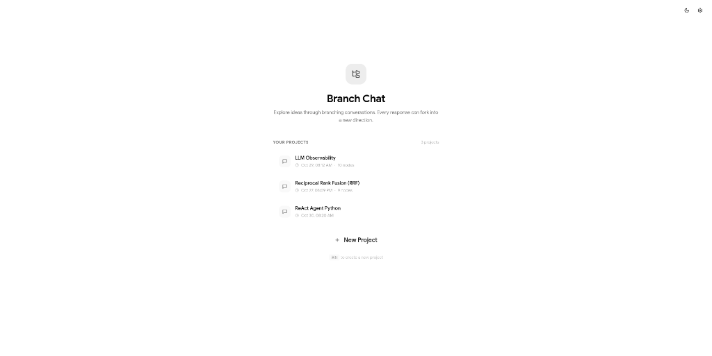
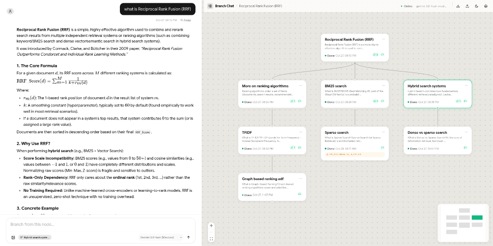

# Branching Chat

An interactive branching conversation tree interface that replaces linear chat with a visual node-based workspace. Routes AI queries through **Google Antigravity (agy)** — one persistent session per project.

  

## Screenshots

<p align="center">
  
</p>
<p align="center"><em>Home — manage your projects at a glance</em></p>

<p align="center">
  
</p>
<p align="center"><em>Branching tree canvas with the chat pane — fork any response into a new direction</em></p>

## Prerequisites

### Node.js (v20+)

**Ubuntu / Debian:**

```bash
# Install Node.js 22.x LTS via NodeSource
curl -fsSL https://deb.nodesource.com/setup_22.x | sudo -E bash -
sudo apt-get install -y nodejs

# Verify installation
node --version   # v22.x.x
npm --version    # 10.x.x
```

<details>
<summary>Alternative: install via <code>nvm</code> (no sudo required)</summary>

```bash
# Install nvm
curl -o- https://raw.githubusercontent.com/nvm-sh/nvm/v0.40.3/install.sh | bash
source ~/.bashrc

# Install and use Node.js LTS
nvm install --lts
nvm use --lts
```

</details>

### Antigravity CLI (`agy`)

Branch Chat uses the **Google Antigravity CLI** to route AI queries. Install it with:

**Ubuntu (snap):**

```bash
sudo snap install antigravity-cli
```

**macOS / Linux (script):**

```bash
curl -fsSL https://antigravity.google/cli/install.sh | bash
```

**Windows (PowerShell):**

```powershell
irm https://antigravity.google/cli/install.ps1 | iex
```

Verify the installation:

```bash
agy --version
```

> **Note:** You need a valid Gemini API key or Google account configured with `agy` for AI responses to work. Without `agy`, the app still runs but falls back to mock responses.

## Quick Start

```bash
# Install dependencies
npm install

# Option 1: Start both servers with one command
./start.sh

# Option 2: Start manually in separate terminals
# Terminal 1: Start the API server (SQLite + agy proxy)
npm run server
# Terminal 2: Start the frontend dev server
npm run dev
```

To stop everything (if started via `start.sh`):

```bash
./stop.sh
```

Open **http://localhost:5173/**

## Architecture

```
┌─────────────┬──────────────────────────────┬─────────────────────┐
│  SIDEBAR    │   TREE CANVAS (React Flow)   │   CHAT PANE         │
│             │                              │                     │
│  Projects   │   ○ Root                     │   Thread history    │
│  Settings   │   ├── ○ Node A               │   (markdown)        │
│  Status     │   │   ├── ○ A1               │                     │
│             │   │   └── ○ A2  ← active     │   ┌───────────────┐ │
│             │   └── ○ Node B               │   │  Chat input   │ │
│             │       └── ○ B1               │   └───────────────┘ │
└─────────────┴──────────────────────────────┴─────────────────────┘
```

```
React SPA ──POST /api/agy/query──▶ Express Server ──spawn──▶ agy CLI
                                         │                      │
                                    SQLite DB            Antigravity Backend
                                  (dfs-chat.db)              (Gemini)
                                         │                      │
React SPA ◀──────── SSE stream ──────────┘◀── NDJSON stream ───┘
```

## Features

### Conversation Tree
- **Linear deep dive** — new messages auto-append as child nodes vertically
- **Branch/Fork** — select any older node, type a new query → forks horizontally
- **Context traversal** — on submit, walks up the tree to root collecting all prompt/response pairs
- **Compress branch** — summarize a messy sub-tree into one consolidated node
- **Node actions** — hover any node for: Branch, View, Prune

### AI Providers (pluggable)
| Provider | Description |
|----------|-------------|
| **Antigravity (agy)** | Default. Routes through local `agy` CLI. One session per project. |
| **Gemini API** | Google's free-tier API (Flash models) |
| **OpenRouter** | Multi-model gateway (Gemini, Claude, GPT, Llama) |
| **Ollama** | Local models (Llama, Mistral, Gemma) |
| **Mock** | Fake responses for UI development |

### Antigravity Session Management
- Each project gets its own `agy` conversation — context persists across messages
- Conversation ID stored in SQLite, resumed with `--conversation` flag
- Model selectable per project via dropdown (Gemini 3.8, Claude, GPT-OSS)
- Session can be reset independently

### Persistence
- **SQLite** (`dfs-chat.db`) — projects, nodes, agy session IDs. No password.
- **localStorage** — provider config only

### UI
- Claude-style aesthetic: off-white, dark gray typography, indigo accents
- Inter font, smooth transitions, glassmorphism-lite
- React Flow canvas with minimap, pan/zoom, custom nodes
- Markdown rendering with syntax-highlighted code blocks
- Streaming responses with blinking cursor

## Tech Stack

| Layer | Technology |
|-------|-----------|
| Frontend | React 19 + TypeScript, Vite |
| Canvas | React Flow (`@xyflow/react`) |
| State | Zustand |
| Markdown | react-markdown + remark-gfm |
| Icons | Lucide React |
| Backend | Express.js + better-sqlite3 |
| AI Engine | Antigravity CLI (`agy`) |
| Runtime | tsx (TypeScript execution) |

## Project Structure

```
DFS-Chat-UI/
├── index.html                 # Entry HTML
├── package.json
├── vite.config.ts             # Vite + proxy to backend
├── tsconfig.json
├── dfs-chat.db                # SQLite database (auto-created)
├── server/
│   ├── index.ts               # Express API server
│   └── db.ts                  # SQLite schema + queries
└── src/
    ├── main.tsx                # React entry
    ├── App.tsx                 # Root layout
    ├── index.css               # Design system
    ├── store/
    │   └── useTreeStore.ts     # Zustand state
    ├── services/
    │   ├── api.ts              # AI provider streaming
    │   └── db.ts               # Frontend REST client
    ├── components/
    │   ├── Sidebar.tsx         # Project list + rename
    │   ├── TreeCanvas.tsx      # React Flow canvas
    │   ├── TreeNode.tsx        # Custom flow node
    │   ├── ChatPane.tsx        # Chat thread + input
    │   ├── ChatMessage.tsx     # Markdown message
    │   └── SettingsModal.tsx   # Provider/model config
    └── types/
        └── index.ts            # TypeScript types
```

## API Endpoints

### Projects
| Method | Endpoint | Description |
|--------|----------|-------------|
| `GET` | `/api/projects` | List all projects |
| `GET` | `/api/projects/:id` | Get project with all nodes |
| `POST` | `/api/projects` | Create project |
| `PATCH` | `/api/projects/:id/rename` | Rename project |
| `DELETE` | `/api/projects/:id` | Delete project |

### Nodes
| Method | Endpoint | Description |
|--------|----------|-------------|
| `POST` | `/api/projects/:pid/nodes` | Create node |
| `PATCH` | `/api/nodes/:id/response` | Update response |
| `PATCH` | `/api/nodes/:id/label` | Update label |
| `DELETE` | `/api/projects/:pid/nodes/:id` | Delete node subtree |
| `POST` | `/api/projects/:pid/nodes/:id/compress` | Compress branch |

### Antigravity
| Method | Endpoint | Description |
|--------|----------|-------------|
| `POST` | `/api/agy/query` | Stream a query (SSE) |
| `GET` | `/api/agy/session/:pid` | Get session info |
| `POST` | `/api/agy/session/:pid/reset` | Reset session |
| `PATCH` | `/api/agy/session/:pid/model` | Change model |

## License

MIT
